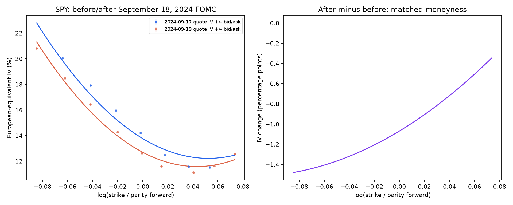

# SPY smile around the September 18, 2024 FOMC

The Fed announced a 50 bp cut at 14:00 EDT on September 18. [Official event statement](https://www.federalreserve.gov/newsevents/pressreleases/monetary20240918a.htm). We compare third-party daily option snapshots from September 17 and 19, both expiring October 18, 2024. These are real historical bid/ask observations, not generated option prices.



```text
      date  n   atm_iv     slope  curvature     rmse
2024-09-17 10 0.137683 -0.589635  11.248796 0.005809
2024-09-19  9 0.126989 -0.514569  11.875550 0.003900
```

ATM IV change: **-1.069 volatility percentage points**. Local slope change: **+0.0751**; curvature change: **+0.6268**. IV is decimal; slope is d(IV)/d log(K/F), curvature is its second derivative. A 1% log-moneyness move changes IV by approximately slope x 1 volatility point locally. The quadratic is descriptive, not an arbitrage-free surface.

## Method and caveats

Invert bid, midpoint and ask through a European Black forward model; use OTM puts below forward and OTM calls above it. Infer each forward from the median of the five closest-to-spot call/put parity pairs (or all available if fewer). Base continuously compounded rate 5.0% is an assumption, not an observed yield. Rate sensitivity is in the CSV.

Reject nonpositive bids, crossed markets, bid below $0.05, relative spreads above 35%, expired contracts and non-invertible prices. Fit local quadratics inside +/-0.10 and restrict comparison curves to the shared support of the retained fitting observations. See quote_audit.json for counts, inversion failures and forward-pair dispersion. Bid/ask-fit coefficients indicate spread sensitivity, not statistical confidence intervals.

SPY options are American-style and SPY pays dividends: the European-equivalent IV and parity forward are approximations. Both observations precede the September 20 ex-distribution date, which lies within the option maturity, so carry and early-exercise effects matter; we do not assume zero dividends. No intraday timestamps, volume or open interest are provided by the dataset, so synchronous/executable quotes cannot be verified. The common expiration has 31 days remaining before and 29 after; time decay and all other intervening news remain confounders. One before/after pair does not identify a causal Fed effect. No option P&L or profitable strategy is inferred.

Raw data is downloaded locally and excluded from Git; the provenance file contains retrieval times, source queries and SHA-256 checksums. Re-run the downloader to reproduce from the public source; a mutable source can be revised.
